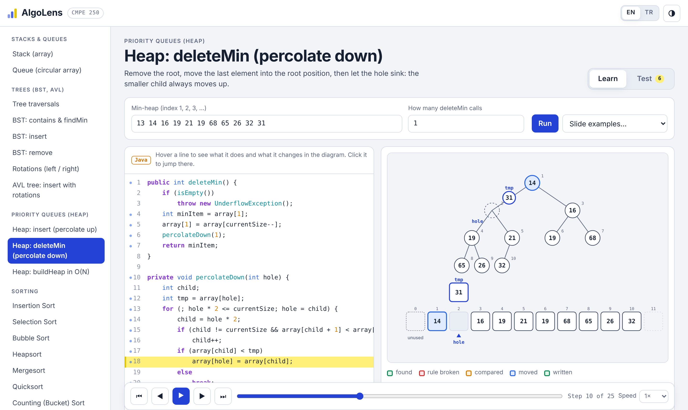
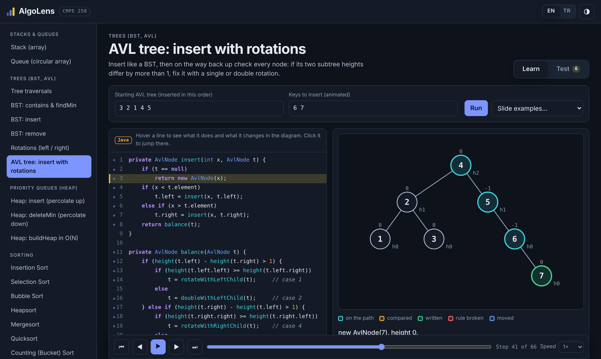
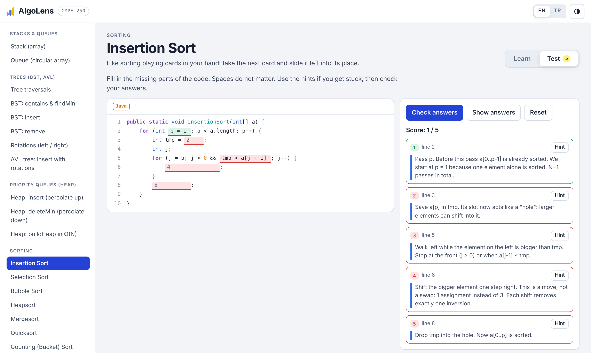

# AlgoLens

**Line-by-line, interactive visualizer for data structures and algorithms.**
Every algorithm is shown as an animated diagram next to real Java code. Step forward and back with the arrows, play it at your own speed, or test yourself by filling in the missing parts of the code.

Built while studying for **CMPE 250 (Data Structures and Algorithms)** at Boğaziçi University. The code follows the course slides (Weiss style), and every explanation is available in **English and Turkish**.



## Features

- **23 algorithms** in 5 topics (list below), each with Java code, a diagram, and notes.
- **Learn tab**, kept simple on purpose
  - The diagram is the main thing: big ‹ › arrows on both sides step backward and forward, a one-sentence caption says what just happened, so it can be followed without reading the code.
  - Zoom in and out, open the diagram full screen, or hide the code panel.
  - The Java code next to it highlights the line that is running.
  - Variables stay in fixed places, so nothing jumps around while you step.
  - Your own input, random input, or the examples from the slides, plus a complexity table.
- **Test tab**: critical parts of the code are blanked out. Fill them in, use hints, check your answers, and see why each line matters.
- **Diagrams that move.** Values keep their identity while they move, so a swap, a percolation, or an AVL rotation glides instead of jumping. During a rotation you can watch the middle subtree change parents.
- EN / TR switch, light / dark theme, keyboard control (← → step, space play/pause), works on phones.

| Topic | Algorithms |
|---|---|
| Stacks & Queues | Stack (array), Queue (circular array) |
| Trees | Traversals (pre/in/post), BST contains & findMin, BST insert, BST remove, Rotations (left/right), AVL insert with all 4 cases |
| Priority Queues | Heap insert (percolate up, sentinel), deleteMin (percolate down), buildHeap in O(N) |
| Sorting | Insertion, Selection, Bubble, Heapsort, Mergesort, Quicksort, Counting sort, Radix sort |
| Hashing | Separate chaining, Linear probing, Quadratic probing, Double hashing |

| AVL rotation (dark theme) | Fill-in-the-blanks test |
|---|---|
|  |  |

## How it works

The core idea is small: **an algorithm records steps, the UI plays them back.**

```
src/
  types.ts            Step, Algorithm and the diagram state types
  engine/
    tracer.ts         Tracer: algorithms call t.snap(label, message, state) after a Java line "runs"
    code.ts           java`...` parser: //@label markers name the lines, so code can refer to them
    scene.ts          tiny animated SVG engine (keyed tokens glide to new positions, edges follow)
    blanks.ts         answer checking for the Test tab
  viz/                one renderer per diagram: array, heap (tree + array), tree, hash table,
                      stack, circular queue, radix buckets
  algorithms/         one file per algorithm: Java code, line notes, step generator, notes, blanks
  ui/                 Learn tab, Test tab, code view
tests/                checks every algorithm against the slide examples and random input
```

Each algorithm is written twice on purpose: once as the **Java code you read**, and once as a **TypeScript step generator** that performs the same operations and takes a snapshot after each line. A `//@label` marker at the end of a Java line connects the two:

```java
for (j = p; j > 0 && tmp < a[j - 1]; j--) {   //@inner
    a[j] = a[j - 1];                          //@shift
```

```ts
a[j] = a[j - 1]; a[j - 1] = null;
t.snap('shift', m(`${a[j].v} moves right`, `${a[j].v} sağa kayar`), A(a, { ... }));
```

Adding a new algorithm means writing one file in `src/algorithms/` and adding it to the list in `src/algorithms/index.ts`.

## Tests

`npm test` runs 88 checks with Vitest:

- every algorithm runs its default input and every preset; every line note and every blank points at a real line;
- all comparison sorts produce sorted output on fixed and random arrays;
- heap results match the slides exactly (insert 14, deleteMin, buildHeap of 15 items);
- BST insert/remove keep in-order sorted; AVL insert stays balanced with correct heights on random input;
- probing tables match the slide example (89, 18, 49, 58, 69 with M = 10).

## Run it

```bash
npm install
npm run dev        # local dev server
npm test           # run the tests
npm run build      # production build in dist/ (deploy to GitHub Pages)
npm run build:single   # everything in one HTML file in dist-single/
```

No framework: plain TypeScript, SVG and CSS, built with Vite.

### Deploy to GitHub Pages

`npm run build`, then publish the `dist/` folder (the included workflow `.github/workflows/pages.yml` does this on every push to `main`; enable Pages → Source: GitHub Actions in the repo settings). The build uses relative paths, so it works under `https://<user>.github.io/<repo>/`.

## License

MIT
